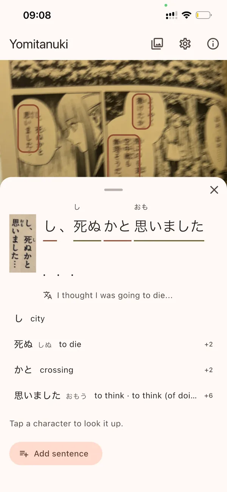

# Yomitanuki

[](https://github.com/Onkyou/yomitanuki/actions/workflows/ci.yml)

Yomitanuki reads physical manga through the iPhone camera: speech bubbles are boxed live on
the camera stream, a tapped bubble is OCRed on the device, each word opens its JMdict entry,
and one tap sends a card to AnkiMobile. Nothing leaves the phone: no server, no network while
reading.

<p align="center">
  
  &nbsp;&nbsp;
  
</p>
<p align="center"><sub>Left: bubbles boxed live on the camera stream. Right: a tapped bubble as a sentence,
with furigana, the on-device translation and a dictionary row per word. The page is from
<em>Sousou no Frieren</em> vol. 1 (Kanehito Yamada, Tsukasa Abe; Shogakukan), shown to illustrate the app.</sub></p>

**Status.** Work packages WP0 to WP6e are merged on `main` and `make gate` is green. The
reader, OCR, dictionary, the sentence sheet with on-device translation (the screenshots
above) and the Anki round trip have run on an iPhone. Still unchecked on a phone: the WP6d
card shapes inside AnkiMobile, translation quality across more bubbles, and per-stage timings.
The checklist is in [docs/PHONE-TESTING.md](docs/PHONE-TESTING.md).

## Repository map

| Path | What it is |
|---|---|
| `app/` | The Flutter app: `lib/{ui,domain,data}`, `test/` mirroring it, `ios/` |
| `app/packages/` | `ort_ffi` (ONNX Runtime over `dart:ffi`) and `translation_ios` (Apple Translation over a method channel) |
| `wp0/` | Two halves: the frozen feasibility spike (reference scripts, kept as they were) and the live model build that `make models` runs (`build_graphs.py`, `check_goldens.py`, `requirements.lock.txt`) |
| `tool/` | The gate proof, the dictionary builder, the OCR scoring script |
| `docs/` | Phone testing checklist, the two screenshots |
| `.agents/`, `.claude/` | The skills and agent definitions the work was done with; `.claude/wpN/` holds each work package's spec and decision log |
| `skills-lock.json` | Pins the skills under `.agents/skills/` to their source and hash |

## Measured

From the WP0 spike (`.claude/wp0/NOTES.md`), on 200 bubble crops from 31 photos of one volume,
kept local (P4). CER and exact match are against manga-ocr's own 4-beam decoding, not against
hand-checked ground truth; most mismatches are the greedy decoder being right where the beam
stutters. Times are on an Apple M2 with ONNX Runtime 1.31 on the CPU, not on the phone.

| | |
|---|---|
| OCR int8 greedy vs the beam reference | CER 2.29 %, exact match 91.0 % (fp32 greedy: 1.89 %, 92.0 %) |
| Exact match of the shipped graphs vs the Python reference | 197 of 200 crops |
| Shipped size | OCR 117 MB (encoder 87 + decoder 30, int8) + detector 28 MB (fp32) |
| OCR per crop, shipped graphs | 86 ms median, 128 ms p90 (encoder 50 ms, decoder 2.3 ms per step) |

## How it was built

The repo is as much about the method as the app. It was built with Claude Code as the
implementer and the author as orchestrator: the author chose the product, the decisions and
the gates, and reviewed every work package; the agent wrote the code and the tests. The
agent tooling under `.agents/skills/` and `.claude/` is committed on purpose. It is part of
the method, not scaffolding.

Every work package follows the same loop:

1. **Spec and plan.** Scope, first tests and exit criteria are written before any code.
   Decisions are numbered and locked: D1 to D10 in [PLAN.md](PLAN.md), DN.x per work
   package in `.claude/wpN/NOTES.md`, binding until explicitly reversed.
2. **Test-first build.** A test goes red before the code that makes it green; a gate is only
   trusted once it has been seen to fail.
3. **Two adversarial reviews** of the diff, in parallel: architecture conformance against
   the skills' checklists, and a correctness, readability, security and performance review.
   Findings go back to the implementer; the package merges when both reviews are clean.
4. **Record.** The reasoning is in the repo: project decisions in [PLAN.md](PLAN.md),
   per-work-package decisions, measurements, leftovers and "what will bite" in
   `.claude/wpN/NOTES.md`.

`make gate` enforces the mechanical part and is identical, line for line, to CI: whole-tree
`dart format`, `flutter analyze --fatal-infos`, the test suites of the app and its two
packages, a self-test that plants an unformatted file, a lint violation, a failing test and a
corrupted golden in turn and checks that the matching step goes red, and an iOS build whose
binary is checked for the ONNX Runtime symbol.

## Architecture

Flutter app in [`app/`](app), layered as `ui/<feature>/{view,view_model}`, `domain` and
`data/{services,repositories}`.

- **Ports and adapters.** Text detection, OCR, the camera frame source, the photo picker,
  the dictionary, sentence translation, Anki export, settings and the OCR capture log are
  ports in `lib/domain/ports`. ONNX Runtime and platform adapters implement them in the
  app; fakes implement them in every other test.
- **Inference never runs on the UI isolate.** Two long-lived worker isolates, one per model
  (detector, OCR), own their ONNX Runtime sessions; the reader talks to them over messages.
- **FFI to the ONNX Runtime C API.** [`app/packages/ort_ffi`](app/packages/ort_ffi) is a
  small typed Dart layer over `ffigen`-generated bindings: runtime, session, session options,
  tensors, CoreML options. Its tests run against the real macOS ONNX Runtime binary, fetched
  and sha256-pinned by the Makefile (ORT 1.31 on macOS for the tests, the 1.30 pod on iOS,
  which the bindings allow for by requesting API version 30).
- **Models are a build output, not source.** `make models` rebuilds the ONNX graphs
  deterministically from a Python environment pinned with package hashes, from weights pinned
  by commit (manga-ocr) and sha256 (comic-text-detector): comic-text-detector for detection,
  manga-ocr (ViT encoder, character-level decoder) for OCR, with the preprocessing baked
  into the graphs so the Dart side feeds BGRA bytes and runs the greedy decode loop. The
  graphs are checked against synthetic goldens in `app/test/goldens/` (rendered text, no book
  content); the goldens are the inference contract the Dart port is tested against.
- **Dictionary.** JMdict and KANJIDIC2 as SQLite, built from the pinned jmdict-simplified
  releases by `make dict`; deinflection and longest match in pure Dart with the repo's own
  rule table.
- **Translation.** Apple's on-device Translation framework through a Swift method-channel
  plugin, [`app/packages/translation_ios`](app/packages/translation_ios).
- **Anki.** AnkiMobile's URL scheme; deck and note types are configurable in the app.
- **Privacy by construction.** Photos of book pages, OCRed book text, model weights and the
  dictionary never enter git (`.gitignore`, decision P4); the gate's fixtures are synthetic.

The Python spike in [`wp0/`](wp0) is the reference implementation the Dart port reproduces,
kept as it was. `tool/` holds the gate proof, the dictionary builder and the OCR scoring
script.

## Build

Needs an Apple silicon Mac with Xcode 26, CocoaPods, Flutter 3.47.2 (pinned in
`app/pubspec.yaml`), GNU Make and [uv](https://docs.astral.sh/uv/). Set your own signing
team in Xcode before running on a device.

```bash
make help     # every target with a one-line description
make models   # build the ONNX graphs into app/assets/models/ (network once, for the weights)
make dict     # build the dictionary SQLite from the pinned JMdict/KANJIDIC2 releases
make gate     # the merge gate: format, analyze, test, mutation proof, iOS builds
```

Then `cd app && flutter run --release -d <device>` on a phone with AnkiMobile installed.
Sentence translation needs iOS 26 with the Japanese and English packs downloaded in
Settings › Apps › Translate.

## Licences

- **This repository:** [GNU General Public License v3.0](LICENSE). The model build imports
  GPL-3.0 code, so GPL-3.0 is the honest licence for the whole.
- **manga-ocr** (kha-white): Apache License 2.0. Weights are built into the app's graphs
  locally and never committed.
- **comic-text-detector** (dmMaze): GNU General Public License v3.0. Weights are built
  locally and never committed.
- **JMdict and KANJIDIC2:** property of the Electronic Dictionary Research and Development
  Group, used under the EDRDG licence (CC BY-SA 4.0). The app shows this attribution:

  > This app uses the JMdict and KANJIDIC2 dictionary files. These files are the property
  > of the Electronic Dictionary Research and Development Group (EDRDG), and are used in
  > conformance with the Group's licence (Creative Commons Attribution-ShareAlike 4.0,
  > CC BY-SA 4.0): https://www.edrdg.org/edrdg/licence.html

- **ONNX Runtime** (Microsoft): MIT License.
- **Deinflection rules:** the repo's own table, inspired by the approach of the Yomitan
  project; no Yomitan code is used.
